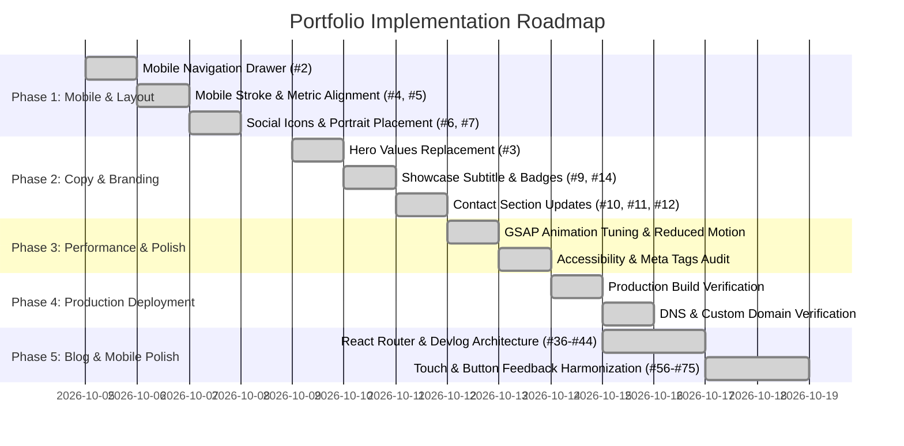

# Product Requirements Document (PRD)

## Project: Software Engineer Portfolio Website (`laanhema.dev`)

- **Document Version**: 1.1.0
- **Status**: Implemented and deployed at `laanhema.dev`. Not in the code: the SEO metadata of Phase 3 (#109) and the live-demo links of US-4 (R-6, #107).
- **Last Updated**: 2026-10-13
- **Author**: Lauri Makkonen (`laanhema`)
- **Target Repository**: `laanhema/swe-portfolio-website-2`
- **Output Location**: `.agents/PRDs/PRD.md`

---

## 1. Executive Summary

The portfolio website (`laanhema.dev`) is a single-page web application built with React 19, TypeScript, Vite 8, Tailwind CSS v4, and GSAP. It presents projects, engineering background, and contact options for full-stack engineer Lauri Makkonen, who has been coding since 2019.

Unlike standard portfolio templates, `laanhema.dev` uses a bold Neo-Brutalist design language with high-contrast typography, 4px solid borders, offset drop shadows, vivid accent colors, and tactile button interactions. This styling makes the site memorable while demonstrating attention to detail and frontend craft.

**Core Value Proposition**:  
Gives hiring managers and recruiters a direct look at full-stack engineering skills, linking to working applications, open-source repositories, and verified experience.

**MVP Goal Statement**:  
Ship a responsive, accessible single-page portfolio that highlights four projects, fixes known mobile layout issues, and provides direct contact paths.

---

## 2. Mission

### 2.1 Product Mission Statement
Present an authentic, technically grounded portfolio that turns visits from recruiters and engineering leads into job conversations.

### 2.2 Core Principles

1. **Substance Over Platitudes**: Replace generic claims with concrete architecture choices, working code repositories, and verifiable experience.
2. **Neo-Brutalist Craftsmanship**: Use an unmistakable design system that balances bold styling with disciplined typography and responsiveness across screen sizes.
3. **Zero-Friction Engagement**: Allow prospective employers and recruiters to assess core competencies within 10 seconds of landing and reach out with a single click.
4. **Performance & Code Quality**: Maintain fast load times, zero layout shifts, strict TypeScript checks, clean component boundaries, and high accessibility standards (WCAG AA).

---

## 3. Target Users

### 3.1 Primary Personas

#### Persona 1: Technical Recruiter / Talent Acquisition ("Sarah")
- **Profile**: Evaluates 30–50 candidate portfolios weekly for frontend, backend, and full-stack engineering roles.
- **Technical Comfort**: Low to Medium.
- **Device Usage**: 50% Desktop, 50% Mobile (browsing via LinkedIn or email links).
- **Needs & Goals**:
  - Quickly identify primary tech stacks (React, TypeScript, Node.js/Express, Angular, Svelte, MongoDB).
  - Verify total years of experience and track record (coding since 2019, 25+ public repositories).
  - Reach out immediately via email or LinkedIn without hunting for contact details.
- **Pain Points**:
  - Truncated text or awkward layouts on mobile devices.
  - Portfolios with broken navigation links or non-working contact forms.
  - Vague lists of skills with no evidence of applied work.

#### Persona 2: Engineering Manager / Tech Lead ("Alex")
- **Profile**: Senior engineering leader hiring for scalable web application and service development.
- **Technical Comfort**: Very High.
- **Device Usage**: Primarily Desktop / Laptop.
- **Needs & Goals**:
  - Inspect repository code quality, Git commits, dependencies, and architectural hygiene.
  - Review live demos or packaged artifacts (e.g., downloadable Android APK, live web apps).
  - Assess whether candidate understands responsive design, performance, and modern toolchains.
- **Pain Points**:
  - Toy projects without real-world utility or proper architecture.
  - Overly generic templates that mask the developer's actual abilities.
  - Sluggish animations or poor layout performance.

#### Persona 3: Peer Engineer / Open-Source Collaborator ("Devin")
- **Profile**: Software engineer looking for collaborators on open-source initiatives or hackathon projects.
- **Technical Comfort**: High.
- **Needs & Goals**: Discover shared technical interests and view creative toolchains (e.g., GSAP, Tailwind v4, Playwright scraping, NgRx SignalStore).

---

## 4. MVP Scope

### 4.1 In Scope

#### Core Functionality
- [x] **Sticky Navigation Bar**: Responsive top bar with personal branding (`laanhema.dev`), desktop anchor links (Work, About, Blog, Contact), and a mobile hamburger menu drawer with toggle state.
- [x] **Hero Section**: High-impact introduction featuring developer title, outline headline ("Building Robust Systems"), personalized engineering values paragraph, "View Work" primary CTA, social icon links (GitHub, LinkedIn), and author portrait.
- [x] **About & Metrics Section**: "The Dev Behind The Code" summary highlighting professional journey since 2019, accompanied by neo-brutalist metric cards (2019 Coding Since, 25 Public Repos, 2000+ Contributions).
- [x] **Curated Work Showcase**: "Selected Works" section displaying 4 featured projects (GymBro App, Tralla, Froots Smoothie App, Distill Design Scraper) with clean tech stack tags, concise descriptions, GitHub source links, and Read Story devlog links.
- [x] **Contact Section**: "Let's Build Something Awesome." contact hub with direct email address link (`lahmakkonen@gmail.com`) and a contact form that opens a prefilled email in the visitor's mail client.
- [x] **Footer**: Consistent site footer with copyright, branding mark, and outbound social channels.
- [x] **Technical Blog & Devlogs**: Responsive client-side blog routing (`/blog`, `/blog/:slug`) with `.brutal-prose` typography and devlog case studies for each featured project.

#### Technical & Design System
- [x] React 19 + TypeScript (strict mode) with Vite 8.
- [x] Tailwind CSS v4 setup with custom theme variables, custom shadow tokens (`--shadow-brutal`), and component utilities (`brutal-border`, `brutal-shadow`, `brutal-shadow-hover`, `brutal-prose`).
- [x] React Router `^8.4.0` for SPA client navigation.
- [x] Noto Sans Variable font typography integration.
- [x] GSAP scroll animations (`ScrollTrigger`): one fade-and-rise reveal per `.animate-on-scroll` element, registered only under `prefers-reduced-motion: no-preference`.
- [x] Mobile-first responsive optimization across 320px, 375px, 768px, 1024px, and 1440px+ breakpoints.

#### Integration & Deployment
- [x] Outbound links to verified GitHub repositories (`laanhema`, `jamktiko`).
- [ ] Outbound links to live application deployments (AWS S3, Netlify). Not implemented: the project cards link to the GitHub repositories and the devlogs only, and the devlogs hold no outbound link (R-6).
- [x] `mailto:` link protocol for native email client launching.
- [x] Production build verified via `tsc -b && vite build`.
- [x] Static deployment readiness for custom domain `laanhema.dev`.

### 4.2 Out of Scope (Deferred to Future Releases)

- [ ] **Server-side Contact API**: Backend handling for form submissions (e.g., Resend, SendGrid, or AWS SES API) — MVP uses `mailto:` and client-side form interface.
- [ ] **Live GitHub API Polling**: Real-time dynamic fetch of repository stars, commit history, and pinned repositories.
- [ ] **Dark / Light Theme Toggle**: Standardized on signature neo-brutalist dark/light hybrid color scheme.
- [ ] **Web Analytics Dashboard**: Custom telemetry or privacy-friendly tracking (e.g., Plausible, PostHog).

---

## 5. User Stories

### US-1: Mobile Navigation Drawer
- **Story**: As a mobile visitor, I want to click the "Menu" button in the navigation bar to expand a navigation drawer, so that I can smoothly jump to Work, About, or Contact sections on my phone.
- **Example**: On an iPhone 14 (390px width), tapping the orange "Menu" button opens a brutalist drawer showing "Work", "About", "Blog", and "Contact". Tapping "Work" smoothly scrolls to the `#work` section and closes the drawer.
- **Acceptance Criteria**: Accessible toggle state, `aria-expanded` attributes, backdrop/drawer dismiss on click.

### US-2: Fast Assessment of Engineering Experience
- **Story**: As a technical recruiter, I want to immediately see how long the developer has been coding and their core competencies upon landing, so that I can qualify them for mid/senior software engineering openings.
- **Example**: Sarah lands on `laanhema.dev`, sees "Software Engineer / Building Robust Systems", reads the values paragraph, and scrolls to the About section displaying "2019 Coding Since" and "2000+ GitHub Contributions".
- **Acceptance Criteria**: Clear typography, zero text truncation, centered metric labels on mobile viewports.

### US-3: Review Project Architecture and Source Code
- **Story**: As an engineering manager, I want to browse featured project cards with technology badges and click directly into the GitHub source code, so that I can evaluate code quality and architecture.
- **Example**: Alex inspects the "GymBro App" card, notes the stack badges (`Angular`, `Ionic`, `Express`, `MongoDB`), and clicks the "Code" button to open `https://github.com/jamktiko/gymbroapp` in a new tab with `noopener` security.
- **Acceptance Criteria**: Concise badges (no verbose text), centered button text, verified URLs.

### US-4: Download Android APK / View Live Demonstrations
- **Story**: As a technical reviewer, I want to launch the live demo or download the application build directly from the showcase card, so that I can test the functioning application firsthand.
- **Example**: A visitor clicks "Download APK" on the GymBro App card and receives the build from the AWS S3 distribution point.
- **Acceptance Criteria**: "Download APK" button text does not wrap or misalign on mobile screens; live links open cleanly.
- **Status**: Not implemented. The cards carry "Code" and "Read Story" only, and no page links to a live demo or an APK (R-6). Tracked as #107: the links go inside the devlogs (OQ-1).

### US-5: Seamless Mobile Contact
- **Story**: As a recruiter browsing on a mobile device, I want to tap the contact email address without horizontal overflow or clipped text, so that I can quickly send an interview invitation.
- **Example**: In the contact section on mobile, the mail icon sits cleanly above or alongside `lahmakkonen@gmail.com` with responsive font sizing that never breaks past viewport boundaries.
- **Acceptance Criteria**: Mail link triggers user's native email client; no text truncation on 320px screens.

### US-6: Engaging Scroll Experience
- **Story**: As a site visitor, I want smooth, subtle entrance animations as I scroll down the page, so that the browsing experience feels polished, modern, and engaging without distracting from the content.
- **Example**: Headings and project cards fade in and translate upward smoothly as they enter the viewport using GSAP ScrollTrigger.
- **Acceptance Criteria**: 60fps rendering, no layout shifting (CLS < 0.05), respects `prefers-reduced-motion`.

---

## 6. Core Architecture & Patterns

### 6.1 Architectural Approach
The application is structured as a modular single-page React application (SPA) with a feature-based folder hierarchy under `src/features/`. Each feature encapsulates its own presentation, component logic, and domain styles, keeping `App.tsx` lightweight as a layout orchestrator.

### 6.2 Directory Structure

```
swe-portfolio-website-2/
├── .agents/
│   ├── PRDs/
│   │   └── PRD.md                      # Product Requirements Document (this document)
│   ├── design-system/
│   │   └── laanhema-design-system/     # DESIGN.md, BUILDING-PAGES.md, component READMEs and previews
│   ├── issues/
│   │   └── todo-issues.md              # Issue & backlog tracking
│   ├── plans/completed/                # Implementation plans of delivered issues
│   ├── reports/                        # Implementation reports
│   └── reviews/                        # Code review reports
├── .claude/
│   └── skills/verify/                  # Skill that drives the site in headless Chrome
├── .github/
│   └── workflows/
│       ├── check.yaml                  # Runs `npm run check` on pull requests
│       └── deploy.yaml                 # Runs `npm run check`, then deploys `dist/` to GitHub Pages on push to main
├── public/
│   ├── 404.html                        # GitHub Pages fallback: stores the requested path and redirects to /
│   ├── CNAME                           # Custom domain (laanhema.dev)
│   ├── favicon.svg                     # Site favicon (Vite's default mark)
│   └── icons.svg                       # Vite template icon sprite, not referenced by the site
├── scripts/
│   ├── check-agents-md.mjs             # Fails when AGENTS.md names a path, version, script or colour the repo lacks
│   └── check-design-system.mjs         # Fails when a design-system class string no longer appears in src/
├── src/
│   ├── assets/
│   │   └── lauri-makkonen-portrait.jpg # Hero portrait asset
│   ├── components/
│   │   ├── Footer.tsx                  # Site-wide footer (brand mark, copyright, GitHub and LinkedIn links)
│   │   ├── Icons.tsx                   # SVG iconography (Github, Linkedin, Mail)
│   │   └── playPress.ts                # Mobile pointerdown press animation helper
│   ├── features/
│   │   ├── blog/
│   │   │   ├── components/             # ArticleHeader, PostCard
│   │   │   ├── data/
│   │   │   │   └── posts.ts            # The four devlog posts; each body is an HTML string
│   │   │   ├── BlogIndex.tsx           # Devlog listing page (/blog)
│   │   │   ├── BlogPost.tsx            # Devlog article reader (/blog/:slug) and its "Post Not Found" view
│   │   │   ├── formatDate.ts           # Formats a post date as "Sep 18, 2026" (UTC)
│   │   │   └── types.ts                # BlogPost data type
│   │   ├── contact/
│   │   │   └── ContactForm.tsx         # Contact section and prefilled-mailto form
│   │   ├── navigation/
│   │   │   ├── Nav.tsx                 # Navigation bar and mobile menu drawer
│   │   │   └── navHelpers.ts           # NAV_LINKS and scrollToSection, shared by the bar, the drawer and the hero CTA
│   │   └── showcase/
│   │       └── ProjectCard.tsx         # Showcase project card component (Code & Read Story)
│   ├── hooks/
│   │   ├── useGsapAnimations.ts        # GSAP ScrollTrigger reveals, reverted on unmount
│   │   └── useScrollReset.ts           # Scrolls to the top when the route changes (blog pages)
│   ├── styles/
│   │   └── global.css                  # Tailwind CSS v4 directives, theme tokens, brutal prose utilities
│   ├── App.tsx                         # Routes, home page layout, landing scroll handling, and project data
│   └── main.tsx                        # React 19 application root
├── AGENTS.md                           # Agent rules (CLAUDE.md points to it)
├── README.md                           # Project overview
├── eslint.config.js                    # ESLint flat config (strictTypeChecked, no type assertions)
├── index.html                          # Entry HTML: title, viewport, SPA redirect restore and reload handling
├── package.json                        # Dependencies and scripts
├── tsconfig.json                       # TypeScript compiler project references
├── tsconfig.app.json                   # Client TypeScript compiler settings
├── tsconfig.node.json                  # TypeScript settings for vite.config.ts
└── vite.config.ts                      # Vite build and plugin configuration
```

### 6.3 Key Design Patterns & Principles

1. **Feature-Sliced Component Organization**: Components are grouped by feature domain (`features/navigation`, `features/showcase`, `features/blog`, `features/contact`) rather than flat component folders, promoting high cohesion and loose coupling.
2. **Design Token Centralization**: Neo-brutalist styling rules (border thickness, hard shadows, brand palette, `.brutal-prose`) are defined via CSS custom properties and Tailwind v4 `@theme` layers in `src/styles/global.css`.
3. **Controlled Animation Lifecycle**: All DOM-dependent animations are contained inside the custom hook `useGsapAnimations`, which registers them inside `gsap.matchMedia()` and reverts that context on unmount, so a page leaves no trigger behind and creates no duplicate. Touch interactions trigger tactile feedback via `playPress` on pointerdown.
4. **Defensive Mobile Layouts**: Flexible containers use responsive modifiers (`flex-col md:flex-row`, `items-start md:items-end`, `break-all`) to guarantee zero overflow across extreme screen dimensions (320px–4K).
5. **GitHub Pages SPA Fallback**: A deep link such as `/blog/tralla` is served `public/404.html`, which stores the path in `sessionStorage` (or a `?p=` query when storage is unavailable) and redirects to `/`. The inline script in `index.html` restores the path before React Router starts. An unknown route redirects to `/`.
6. **Anchor Landings Under the Sticky Bar**: `scroll-padding-top` in `global.css` equals the height of the nav bar and must change with it. A first landing on a hash is re-anchored on each reflow for up to 2 seconds (`ANCHOR_HOLD_MS` in `App.tsx`), or until the visitor scrolls or touches the page.
7. **Lazy Blog Routes**: `BlogIndex` and `BlogPost` load through `React.lazy`, so the home page bundle does not carry the blog.

---

## 7. Tools / Features Breakdown

### Feature 1: Navigation & Mobile Drawer (`src/features/navigation/Nav.tsx`)
- **Desktop Navigation**: Sticky top navigation bar featuring high-contrast brand mark `laanhema.dev` with orange dot accent, anchor links (`/#work`, `/#about`, `/#contact`), and route link (`/blog`) with hover underline animations. The brand mark links to `/` and scrolls to the top. On a blog page a section link navigates to the home page and lands on that section.
- **Mobile Menu Drawer**: High-contrast "Menu" / "Close" button toggling a drawer menu (shown and hidden without a transition) with accessible ARIA attributes (`aria-expanded`, `aria-controls="mobile-menu"`, and an `aria-label` of "Open menu" or "Close menu"), smoothly scrolling to target anchors or navigating to routes upon selection.

### Feature 2: Hero Section (`src/App.tsx`)
- **Visual Impact**: Bold headline with dual-style treatment (solid black text and stroked hollow text `Building Robust Systems`).
- **Personal Value Statement**: Authentic paragraph reflecting engineering philosophy and software delivery approach.
- **Primary Actions**: Neo-brutalist "View Work" button linking to `#work` alongside prominent social media icon buttons (GitHub, LinkedIn).
- **Hero Portrait**: High-quality portrait (`lauri-makkonen-portrait.jpg`) positioned above the fold with brutalist border and offset shadow.

### Feature 3: About & Credibility Metrics (`src/App.tsx`)
- **Headline**: "The Dev Behind The Code." with cyan accent highlights.
- **Narrative**: Concise summary of coding journey since 2019, combining technical engineering depth with strong communication and leadership skills.
- **Metric Cards**:
  - Yellow Card: "2019 Coding Since" (vertically centered and left-aligned, like the other two cards).
  - Orange Card: "25 Public Repos".
  - Cyan Card: "2000+ GitHub Contributions This Year".

### Feature 4: Project Showcase (`src/features/showcase/ProjectCard.tsx`)
- **Section Heading**: "Selected Works" with subtitle "A few projects I've built recently."
- **Featured Projects**:
  1. **GymBro App**: Gamified gym-tracker app for Android (Angular, Ionic, Express, MongoDB).
  2. **Tralla**: Trello-like Kanban board application (Angular, Taiga UI, NgRx SignalStore).
  3. **Froots Smoothie App**: Smoothie recipe and nutritional exploration app (Svelte, TypeScript, Tailwind).
  4. **Distill Design Scraper**: Design system scraper and color extractor (Next.js, React, Playwright, Sharp, Culori, Zod).
- **Card Design**: Distinct background color per card (`#ff3e00`, `#00e5ff`, `#facc15`, `#a855f7`), white square-cornered badges for tech stack tags, and brutalist dual-action buttons ("Code" linking to repository and "Read Story" linking to devlog article).

### Feature 5: Contact Hub & Form (`src/features/contact/ContactForm.tsx`)
- **Headline**: "Let's Build Something Awesome." with orange accent.
- **Status Statement**: "I'm currently open to new job offers! Drop me a message and lets chat about it."
- **Direct Mail Contact**: `lahmakkonen@gmail.com` with Mail icon, responsive stacking, and `break-all` wrapping so the address never overflows on mobile.
- **Interactive Form**: Inputs for Name, Email, and Message with brutalist border styling, focus states, pointer cursor on submit, and client-side handling. All three fields are required. On submit the form opens the visitor's mail client through `mailto:lahmakkonen@gmail.com` with the subject "Contact from {name}" and the name, email and message in the body. Nothing is sent to a server, and the form shows no confirmation.

### Feature 6: Engineering Blog & Devlogs (`src/features/blog/`)
- **Devlog Index (`/blog`)**: Displays header "Field Notes", intro narrative, and grid of `PostCard` entries linking to individual devlog articles. There are four posts, one per featured project, each filled with its own accent color.
- **Article Reader (`/blog/:slug`)**: Displays article header, publish date, read time, tech tags, and formatted `.brutal-prose` content with responsive tables and code snippets. Each article ends with the contact section. An unknown slug shows a "Post Not Found." card with a link back to `/blog`.

---

## 8. Technology Stack

### 8.1 Core Technologies & Versions

| Layer | Technology | Version | Purpose |
|---|---|---|---|
| **Runtime / Library** | React | `^19.2.7` | UI component library |
| **DOM Renderer** | React DOM | `^19.2.7` | DOM rendering engine |
| **Language** | TypeScript | `~6.0.2` | Static type safety and strict checking |
| **Build Tool** | Vite | `^8.1.1` | Ultra-fast HMR and production bundling |
| **Routing** | React Router | `^8.4.0` | Client-side routing for SPA and devlog views |
| **Styling** | Tailwind CSS | `^4.3.2` | Utility-first CSS engine with `@tailwindcss/vite` |
| **Animations** | GSAP | `^3.15.0` | High-performance scroll and timeline animations |
| **Typography** | `@fontsource-variable/noto-sans` | `^5.3.0` | Self-hosted variable font for optimal typography |
| **Code Quality** | ESLint | `^10.6.0` | Static linting and code style enforcement |

### 8.2 Design Tokens

```css
/* Core Color Tokens */
--color-bg-primary: #f8f9fa;      /* Clean off-white canvas */
--color-text-primary: #121212;    /* Near-black contrast text */
--color-accent: #ff3e00;          /* Svelte/Brutalist energetic orange */
--color-accent-cyan: #00e5ff;     /* Vivid electric cyan */
--color-accent-yellow: #facc15;   /* Punchy amber yellow */
--color-accent-purple: #a855f7;   /* Creative purple */

/* Brutalist Shadow Tokens */
--shadow-brutal: 6px 6px 0px 0px #121212;
--shadow-brutal-sm: 3px 3px 0px 0px #121212;
```

The 4px border is the `.brutal-border` class (`border-4 border-text-primary`), not a token.

---

## 9. Security & Configuration

### 9.1 Security Specifications
- **External Link Hardening**: All outbound links targeting external services (GitHub, LinkedIn, AWS S3, Netlify) must strictly enforce `target="_blank"` and `rel="noopener noreferrer"` to prevent tab-nabbing vulnerabilities.
- **Client Sanitization**: Input fields in the contact form must be sanitized against script injection before triggering mail or dispatch routines. As built, the three values are trimmed and passed through `encodeURIComponent` into the `mailto:` URL, and the page never renders them.
- **Zero Exposed Secrets**: No API keys, credentials, or private configuration tokens in the client bundle. All environment configurations reside in `.env` files if needed.
- **Content Security**: Ensure fonts and external assets conform to standard HTTPS transport. The font and the portrait are bundled with the site, and the site requests nothing from another origin. No `Content-Security-Policy` is set. Devlog bodies are static HTML strings from `posts.ts`, rendered with `dangerouslySetInnerHTML`.

### 9.2 Configuration Management
- `vite.config.ts`: Configures `@vitejs/plugin-react` and `@tailwindcss/vite`.
- `public/CNAME`: Configures custom domain routing for `laanhema.dev`.
- `tsconfig.app.json`: Strict TypeScript compiler options with `noEmit: true`, `jsx: react-jsx`, and strict type rules (`strict`, `noUncheckedIndexedAccess`, `exactOptionalPropertyTypes`).
- `.github/workflows/check.yaml` and `deploy.yaml`: Both run `npm run check` (lint, the two docs checks, build) on Node 22. The deploy workflow then publishes `dist/` to GitHub Pages.
- `public/404.html`: GitHub Pages fallback for deep links (section 6.3, pattern 5).

---

## 10. API & Communication Specification

As a client-side single-page portfolio application, MVP interactions leverage client protocols with planned migration to serverless endpoints:

### 10.1 MVP Direct Mail Interaction
- **Trigger**: Direct click on `mailto:lahmakkonen@gmail.com` (no subject), or a submit of the contact form.
- **Protocol**: Standard `mailto:` URI scheme. The form builds the subject and the body from its fields:
  ```
  mailto:lahmakkonen@gmail.com?subject=Contact%20from%20Jane%20Smith&body=Name%3A%20Jane%20Smith%0AEmail%3A%20jane.smith%40techcorp.com%0A%0AMessage%3A%0AHello
  ```

### 10.2 Planned Serverless Contact Endpoint (Post-MVP)
- **Endpoint**: `POST /api/contact`
- **Headers**: `Content-Type: application/json`
- **Request Body**:
  ```json
  {
    "name": "Jane Smith",
    "email": "jane.smith@techcorp.com",
    "message": "We have an open Senior Full-Stack role that aligns with your background."
  }
  ```
- **Response**: `200 OK` (`{ "success": true, "message": "Email dispatched successfully" }`).

---

## 11. Success Criteria

### 11.1 Functional Verification Checklist
The ticks rest on the code alone, read on 2026-10-13. The product was not run for this check.

- [x] Top bar "Menu" button opens and closes the mobile navigation menu smoothly on screens < 768px.
- [x] Navigating via mobile drawer scrolls to the correct section and dismisses the drawer.
- [x] Hero description features personalized engineering values rather than placeholder text.
- [x] "Robust" stroked outline text thickness scales appropriately on mobile devices.
- [x] "2019 Coding Since" metric card content is centered vertically and left-aligned like the other metric cards (#28).
- [x] Hero social media icon buttons form a clean, straight row on all screen sizes.
- [x] Hero portrait is positioned prominently above the fold on initial load.
- [x] "Selected Works" heading is left-aligned on mobile to match previous section headers.
- [x] Showcase subtitle reads "A few projects I've built recently."
- [x] Email link in contact section never clips or truncates on 320px mobile viewports.
- [x] Contact section headline reads "Let's Build Something Awesome."
- [x] Contact paragraph reads "I'm currently open to new job offers! Drop me a message and lets chat about it."
- [x] Project card dual-action buttons provide "Code" and "Read Story" links.
- [x] GymBro App tags read concisely: `Angular`, `Ionic`, `Express`, `MongoDB`.

### 11.2 Quality & Performance Indicators
- **Lighthouse Performance Score**: $\ge$ 95 on desktop, $\ge$ 90 on mobile. Not measured.
- **Cumulative Layout Shift (CLS)**: $< 0.05$. Not measured.
- **First Contentful Paint (FCP)**: $< 1.2\text{s}$. Not measured.
- **TypeScript Errors**: Zero errors (`npm run build` exits with code 0). Met on 2026-10-13.
- **ESLint Errors**: Zero errors (`npm run lint` exits with code 0). Met on 2026-10-13.
- **Accessibility**: WCAG 2.1 Level AA color contrast compliance on all interactive elements. Not met: see R-7 (#108).

---

## 12. Implementation Phases

Phases 1 and 2 landed through pull requests #15–#27 (issues #2–#14), and Phase 5 through #45–#54 (the blog, issues #35–#44) and #60–#93 (interaction polish, issues #56–#91). Follow-up work landed through #32–#34 (issues #28, #29, #31) and #100–#106 (the code-review issues #94–#99 and the split of the deploy workflow).



### Phase 1: Mobile Responsiveness & Layout Stabilization
- **Status**: Completed
- **Goal**: Resolve all functional and visual bugs across mobile and desktop viewports.
- **Deliverables**:
  - [x] Implement mobile navigation toggle drawer in `src/features/navigation/Nav.tsx` (#2).
  - [x] Adjust stroked "Robust" text styling for responsive stroke width (#4).
  - [x] Center "2019 Coding Since" metric content on mobile (#5).
  - [x] Guarantee flex alignment and prevent wrapping on hero social icons (#6).
  - [x] Elevate hero portrait positioning for immediate above-the-fold visibility (#7).
  - [x] Align "Selected Works" heading to left on mobile (#8).
  - [x] Fix "Download APK" button text centering and container padding in `ProjectCard.tsx` (#13). The card has no such button since #42 (Phase 5).
- **Validation**: Test viewports at 320px, 375px, 768px, and 1280px in responsive browser preview.

### Phase 2: Content Personalization & Branding Alignment
- **Status**: Completed
- **Goal**: Replace all placeholder copy and refine project badges to present an authentic professional narrative.
- **Deliverables**:
  - [x] Draft and replace hero description with real engineering values and background (#3).
  - [x] Update showcase section subtitle to "A curated selection of my recent projects." (#9). The subtitle now reads "A few projects I've built recently."
  - [x] Refactor project tags to concise identifiers (e.g. GymBro App: `['Angular', 'Ionic', 'Express', 'MongoDB']`) (#14).
  - [x] Stack mail icon cleanly above email address on mobile screens to prevent truncation (#10).
  - [x] Update contact section headline to "Let's Build Something Awesome." (#11).
  - [x] Update contact paragraph to emphasize availability for new job offers (#12).
- **Validation**: Content review across all sections; ensure zero placeholder text remains.

### Phase 3: Performance, SEO & Accessibility Audit
- **Status**: Completed
- **Goal**: Optimize load times, animation performance, search engine metadata, and assistive technology support.
- **Deliverables**:
  - [x] Audit GSAP animations with `ScrollTrigger.refresh()` and `prefers-reduced-motion` support. Reduced motion is handled through `gsap.matchMedia()` (#97); the code does not call `ScrollTrigger.refresh()`.
  - [ ] Add rich SEO metadata in `index.html` (description, OpenGraph image, Twitter card). Not implemented: `index.html` holds the title "laanhema.dev", the favicon link and the viewport tag only.
  - [x] Verify keyboard tab order and focus rings on all interactive buttons and inputs.
- **Validation**: Google Lighthouse score $\ge 90$ across Performance, Accessibility, and SEO. Not measured.

### Phase 4: Production Deployment & Verification
- **Status**: Completed
- **Goal**: Deploy the validated build to static hosting with custom domain routing.
- **Deliverables**:
  - [x] Verify `npm run build` and `npm run lint` pass cleanly with zero warnings.
  - [x] Deploy static bundle to GitHub Pages / hosting infrastructure. The deploy workflow succeeded for the latest push to `main` (observed on 2026-10-13).
  - [x] Verify DNS and SSL certificate for `laanhema.dev`. GitHub Pages reports the custom domain `laanhema.dev`, an approved certificate that expires on 2026-12-31, and enforced HTTPS (observed on 2026-10-13).
- **Validation**: Public site live and verified on real mobile and desktop hardware.

### Phase 5: Engineering Blog & Mobile Interaction Polish
- **Status**: Completed
- **Goal**: Introduce project devlogs, client-side routing, `.brutal-prose` typography, and solve mobile touch/interaction edge cases.
- **Deliverables**:
  - [x] Install React Router and establish SPA redirection for GitHub Pages (#36, #43).
  - [x] Add design tokens and `.brutal-prose` typography styles (#35).
  - [x] Create devlog models, PostCard, ArticleHeader, BlogIndex, and BlogPost article reader (#37-#41).
  - [x] Update ProjectCard to 2-button layout linking to Devlogs ("Read Story") and code (#42).
  - [x] Refine mobile touch feedback and pointerdown animations via `playPress` (#56, #71-#73).
  - [x] Stack blog post prose tables responsively on narrow viewports (#74).
  - [x] Remove soft blurred glows behind hero to enforce clean neo-brutalist aesthetic (#88).

---

## 13. Future Considerations (Post-MVP)

1. **Serverless Contact Form Dispatcher**: Integrate a lightweight serverless handler (e.g., Cloudflare Workers or Vercel Functions with Resend) to deliver messages directly to email inbox without requiring an email client.
2. **Dynamic GitHub Live Activity**: Connect to GitHub REST/GraphQL API to show real-time commit activity, recent repository pushes, and live star counts.
3. **Interactive Project Demos / Modals**: Provide expanded case study overlays with architecture diagrams, challenge summaries, and tech stack breakdowns for each flagship project.
4. **Theme Switcher**: Provide an optional dark/light neo-brutalist theme toggle while maintaining signature contrast.

### 13.1 Specified, Not Built

1. **SEO Metadata**: The description, OpenGraph image and Twitter card of Phase 3 (#109).
2. **Live Demo and APK Links**: The outbound links to live deployments of section 4.1 and US-4 (R-6, #107).
3. **Link Validation in CI**: The automated check of external links that R-3 names.
4. **Automated Cross-Breakpoint Visual Checks**: The checks that R-1 names.

---

## 14. Risks & Mitigations

| Risk | Impact | Likelihood | Status | Mitigation Strategy |
|---|---|---|---|---|
| **R-1: Mobile Layout Regressions** | High | Medium | Partly mitigated: the mobile-first utilities are in place; no automated visual check runs in CI (the `verify` skill drives the site on demand) | Use strict mobile-first Tailwind utilities and enforce automated cross-breakpoint visual checks (320px, 375px, 768px, 1024px). |
| **R-2: GSAP Performance Jitter on Low-End Devices** | Medium | Low | Mitigated | Limit animations to hardware-accelerated CSS properties (`transform`, `opacity`). Support `prefers-reduced-motion` media query to disable heavy motion. |
| **R-3: Broken External Demo / Repo Links** | High | Low | Not mitigated: no link validation runs in CI | Conduct automated link validation in CI/CD pipeline and maintain stable CDN URLs for hosted artifacts (AWS S3, Netlify). |
| **R-4: Visual Inconsistency in Brutalist Elements** | Medium | Medium | Mitigated | Maintain centralized Tailwind `@theme` variables (`--shadow-brutal`) and the `.brutal-border` class, and reusable component abstractions rather than ad-hoc inline styles. |
| **R-5: Mobile Contact Submit Tap Inconsistency** | Medium | Low | Resolved (#87, fixed by #56) | Known issue TODO-43: First tap on Send Message on mobile touch screens may be swallowed when soft keyboard shifts layout or sticky hover occurs. The button now lifts only under `@media (hover: hover)` and plays its press on pointerdown. |
| **R-6: No Live Demo or APK Link (US-4)** | Medium | Certain | Known issue | `ProjectCardProps` has `repoUrl` and `postSlug` only, and `posts.ts` holds no outbound link, so a reviewer cannot reach a live application or the APK from the site. A demo link in the GymBro and Froots devlogs restores the story (decided in OQ-1, tracked as #107). |
| **R-7: Contrast Below WCAG AA on Accent Elements** | Medium | Certain | Known issue | White on `#ff3e00` is 3.53:1 and `#ff3e00` on the `#f8f9fa` canvas is 3.35:1, both under the 4.5:1 that AA asks of text below 18.66px bold. It shows on the mobile "Menu" button (16px bold, `Nav.tsx`) and on the hover color of the nav links (18px bold). Ink text (`#121212`) on the accent fill reads 5.3:1, and an accent underline in place of accent text fixes the hover. Tracked as #108, which also covers the "← All posts" hover, the email link hover on mobile, and the "Post Not Found" badge and button. |

### 14.1 Open Questions

- **OQ-1** (resolved on 2026-10-13): Should the site link to live demos and the GymBro APK again (on the project card, or inside each devlog), or is US-4 retired now that the cards lead to the devlogs? Outcome: the links go inside the GymBro and Froots devlogs, and the project cards keep their two buttons. The work is #107.

---

## 15. Appendix

### 15.1 Related Documents
- Source Task Backlog: [`TODO.md`](../../TODO.md) (not tracked by git)
- Tracked Issue Backlog: [`.agents/issues/todo-issues.md`](../issues/todo-issues.md)
- Global Styles & Design System: [`src/styles/global.css`](../../src/styles/global.css)
- Design System Reference: [`DESIGN.md`](../design-system/laanhema-design-system/DESIGN.md), [`BUILDING-PAGES.md`](../design-system/laanhema-design-system/BUILDING-PAGES.md)
- Delivery Records: [plans](../plans/completed/), [implementation reports](../reports/), [review reports](../reviews/)

### 15.2 Featured Project Repository Links
- **GymBro App**: [jamktiko/gymbroapp](https://github.com/jamktiko/gymbroapp) (Live APK on AWS S3)
- **Tralla**: [laanhema/tralla](https://github.com/laanhema/tralla)
- **Froots Smoothie App**: [jamktiko/smoothie_testi](https://github.com/jamktiko/smoothie_testi) (Live on Netlify)
- **Distill Design Scraper**: [laanhema/distill-design-scraper](https://github.com/laanhema/distill-design-scraper)
